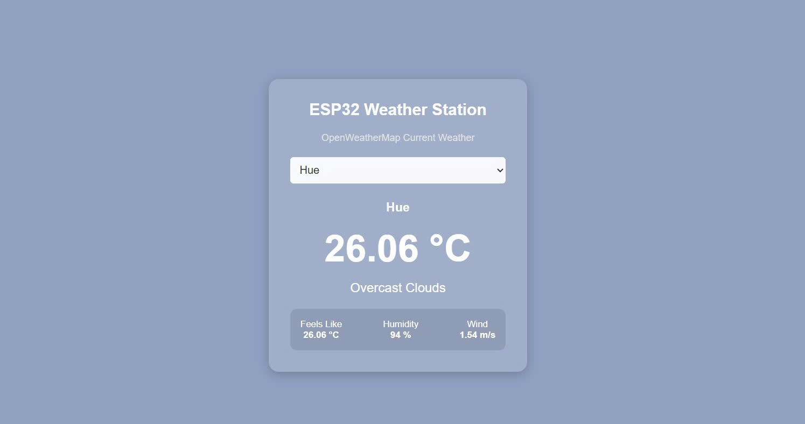
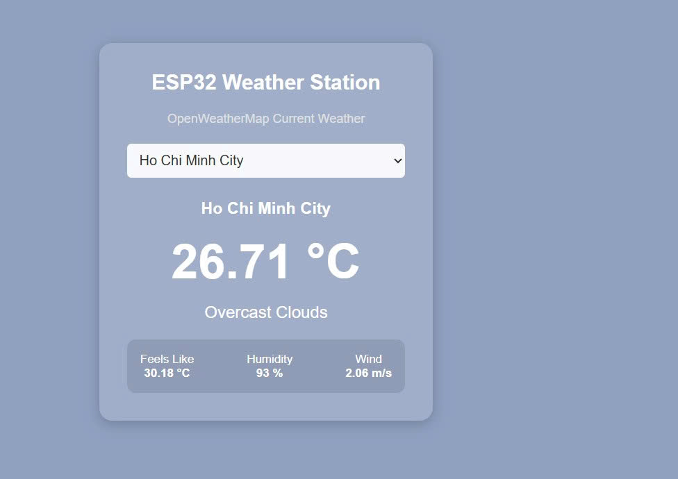
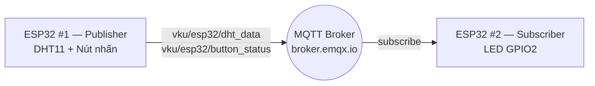
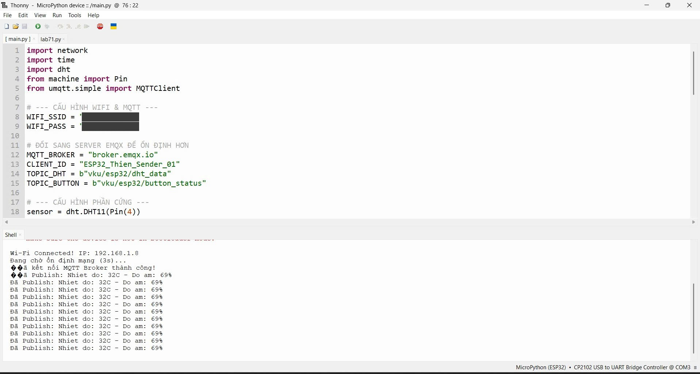
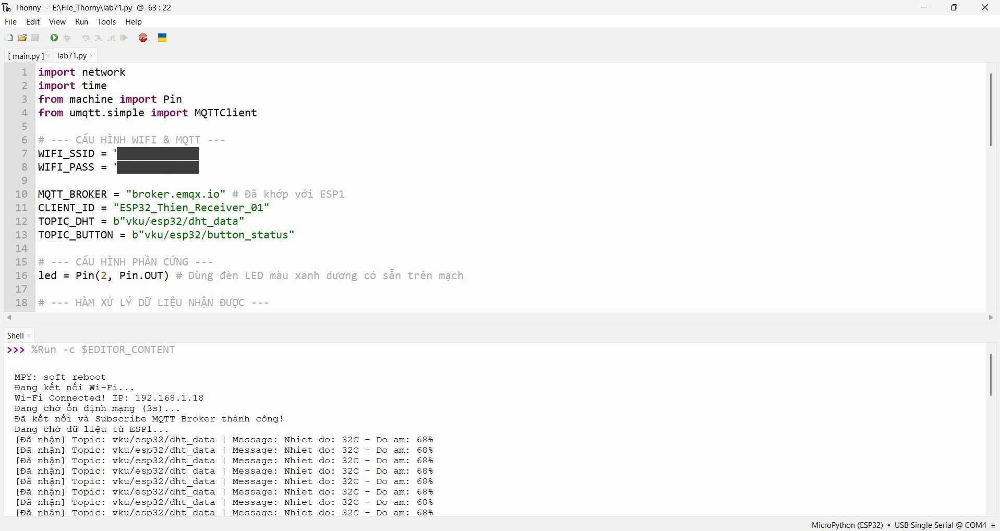
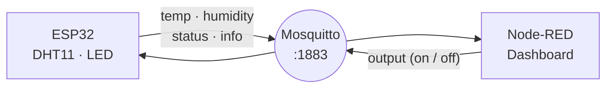
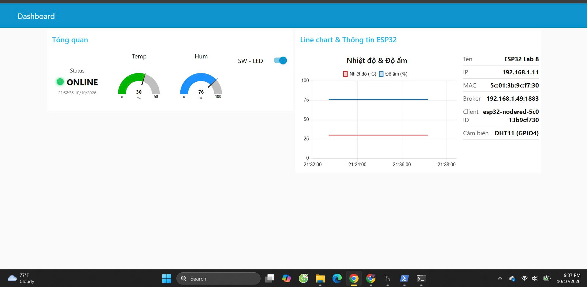
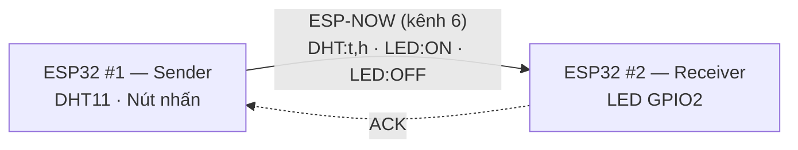

<div align="center">

# 🐍 Embedded Python Projects

**Tổng hợp các bài thực hành môn Embedded Python — từ Python cơ bản đến IoT với ESP32, MQTT, Node-RED và ESP-NOW**


</div>

---

## 📑 Mục lục

- [Tổng quan các Lab](#-tổng-quan-các-lab)
- [Chi tiết từng Lab](#-chi-tiết-từng-lab)
- [Bắt đầu nhanh](#-bắt-đầu-nhanh)
- [Công nghệ sử dụng](#-công-nghệ-sử-dụng)
- [Cấu trúc thư mục](#-cấu-trúc-thư-mục)
- [Tác giả](#-tác-giả)

---

## 📊 Tổng quan các Lab

| Lab | Chủ đề | Phần cứng | Kiến thức chính |
|:---:|--------|-----------|-----------------|
| [**1**](#lab-1--python-cơ-bản--oop) | Python cơ bản & OOP | — | Procedural, Class, Inheritance, Encapsulation |
| [**2**](#lab-2--led-matrix-8x8) | LED Matrix 8x8 | ESP32, MAX7219 | GPIO, Hardware SPI |
| [**3**](#lab-3--interrupt-timer-pwm--rgb-led) | Interrupt, Timer, PWM & RGB LED | ESP32, LED, RGB LED, nút nhấn | Interrupt, Timer, PWM, Debounce |
| [**4**](#lab-4--http-client--web-server-trên-esp32) | HTTP Client & Web Server | ESP32, LED | Wi-Fi, HTTP GET/POST, Socket |
| [**5**](#lab-5--giám-sát-dht11-realtime) | Giám sát DHT11 realtime | ESP8266, DHT11 | Web Server, JSON API, Chart.js |
| [**6**](#lab-6--trạm-thời-tiết-openweathermap) | Trạm thời tiết OpenWeatherMap | ESP32 | REST API, JSON, Garbage Collector |
| [**7**](#lab-7--giao-tiếp-2-esp32-qua-mqtt) | Giao tiếp 2 ESP32 qua MQTT | 2 × ESP32, DHT11, nút nhấn | MQTT Publish / Subscribe |
| [**8**](#lab-8--esp32--mqtt--node-red-dashboard) | MQTT + Node-RED Dashboard | ESP32, DHT11 | Mosquitto, Node-RED, LWT, Retain |
| [**9**](#lab-9--giao-tiếp-không-dây-esp-now) | Giao tiếp không dây ESP-NOW | 2 × ESP32, DHT11, nút nhấn | ESP-NOW, MAC, ACK |

---

## 📚 Chi tiết từng Lab

### Lab 1 — Python cơ bản & OOP

> 📁 [`Lab1/`](Lab1) · 📄 [`lab1.py`](Lab1/lab1.py)

Bài toán **quản lý sinh viên** (nhập thông tin, xếp loại theo GPA, thống kê, tìm kiếm theo mã SV) được giải theo 2 cách:

| Bài | Cách tiếp cận |
|:---:|---------------|
| 1 | Lập trình **thủ tục** (Procedural) — hàm, list, dictionary |
| 2 | Lập trình **hướng đối tượng** (OOP) |

**Kiến thức:** `Class & Object` · `Constructor` · `Attribute & Method` · `Inheritance` · `Encapsulation`

---

### Lab 2 — LED Matrix 8x8

> 📁 [`Lab2/`](Lab2) · 📄 [`lab2.py`](Lab2/lab2.py)

Điều khiển LED Matrix 8x8 (IC **MAX7219**) bằng MicroPython qua giao tiếp **Hardware SPI**.

- Cuộn chữ hiển thị thông tin lớp (VD: `23IC`) và mã sinh viên (VD: `23CE076`).
- Tự định nghĩa font chữ bằng bảng mã Hexadecimal.

| MAX7219 | ESP32 |
|:-------:|:-----:|
| DIN | GPIO23 (MOSI) |
| CLK | GPIO18 (SCK) |
| CS  | GPIO22 |

**Kiến thức:** `GPIO` · `Hardware SPI` · `MAX7219 Register Control` · `Hexadecimal Font Mapping` · `String Scrolling`

---

### Lab 3 — Interrupt, Timer, PWM & RGB LED

> 📁 [`Lab3/`](Lab3) · 📄 [`lab3.py`](Lab3/lab3.py)

Dùng nút nhấn (ngắt cạnh xuống) để chuyển giữa 3 chế độ:

| Mode | Hoạt động |
|:----:|-----------|
| 1 | LED đơn nhấp nháy bằng **Hardware Timer** |
| 2 | LED sáng dần / tối dần (**PWM Fading**) |
| 3 | LED RGB chuyển màu tuần tự |

- Chống dội nút nhấn bằng **Software Debounce**.

**Kiến thức:** `GPIO` · `Interrupt` · `Hardware Timer` · `PWM` · `RGB LED` · `Software Debounce`

---

### Lab 4 — HTTP Client & Web Server trên ESP32

> 📁 [`Lab4/`](Lab4)

Kết nối ESP32 với Wi-Fi, làm việc với HTTP ở cả hai vai trò: **client** (gọi Web API) và **server** (phục vụ trang Web điều khiển).

| File | Nội dung |
|------|----------|
| [`lab41.py`](Lab4/lab41.py) | Kết nối Wi-Fi, in IP · **HTTP GET** thời tiết Hà Nội từ Open-Meteo · **HTTP POST** dữ liệu JSON lên `httpbin.org` |
| [`lab42.py`](Lab4/lab42.py) | **Web Server** bằng Socket, điều khiển LED (GPIO2) với 3 nút **ON / OFF / BLINK** — chế độ nháy chạy non-blocking |
| [`lab43.py`](Lab4/lab43.py) | **IoT Dashboard**: kết hợp Web Server + HTTP Client — hiển thị IP, trạng thái Wi-Fi, LED, thời tiết (nhiệt độ, độ ẩm, gió) tự cập nhật mỗi 30 giây, tự kết nối lại khi mất Wi-Fi |

**Kiến thức:** `Wi-Fi STA` · `urequests` · `HTTP GET/POST` · `Socket` · `REST API` · `JSON` · `HTML/CSS`

---

### Lab 5 — Giám sát DHT11 realtime

> 📁 [`Lab5/`](Lab5) · 📄 [`lab5.py`](Lab5/lab5.py)

Web Server trên **ESP8266** hiển thị nhiệt độ & độ ẩm từ **DHT11** dưới dạng biểu đồ đường realtime.

- Endpoint `GET /data` trả về JSON: `{"temperature": 30, "humidity": 76}`.
- Trang Web dùng **Chart.js**, gọi `/data` mỗi **5 giây**, giữ 10 điểm dữ liệu gần nhất.

| DHT11 | ESP8266 |
|:-----:|:-------:|
| DATA | GPIO14 (D5) |

**Kiến thức:** `ESP8266` · `DHT11` · `Socket` · `JSON` · `JavaScript Fetch API` · `Chart.js`

---

### Lab 6 — Trạm thời tiết OpenWeatherMap

> 📁 [`Lab6/`](Lab6) · 📄 [`lab61.py`](Lab6/lab61.py)

Trạm thời tiết trên ESP32, chọn thành phố từ dropdown để xem thời tiết hiện tại qua **OpenWeatherMap API**.

- Hỗ trợ: Huế · Hà Nội · TP.HCM · Tokyo · London · New York.
- Hiển thị nhiệt độ, nhiệt độ cảm nhận, độ ẩm, sức gió và mô tả thời tiết.
- Giải phóng RAM bằng `gc`, timeout socket 3 giây, bỏ qua request `favicon.ico` để tránh treo thiết bị.

<div align="center">
  
  
</div>

**Kiến thức:** `REST API` · `JSON Parsing` · `urequests` · `HTML Form` · `Garbage Collection (gc)`

---

### Lab 7 — Giao tiếp 2 ESP32 qua MQTT

> 📁 [`Lab7/`](Lab7)

Hai board ESP32 trao đổi dữ liệu qua broker công cộng **`broker.emqx.io`**.



| File | Vai trò | Chức năng |
|------|---------|-----------|
| [`lab7.py`](Lab7/lab7.py) | **Publisher** (ESP32 #1) | Đọc DHT11 mỗi 2 giây → publish `vku/esp32/dht_data` · Nút nhấn → publish `ON` / `OFF` lên `vku/esp32/button_status` |
| [`lab71.py`](Lab7/lab71.py) | **Subscriber** (ESP32 #2) | Subscribe 2 topic, in dữ liệu ra Terminal, bật/tắt LED theo nút nhấn của ESP32 #1 |

| Thiết bị | Chân ESP32 |
|----------|:----------:|
| DHT11 DATA (ESP32 #1) | GPIO4 |
| Nút nhấn (ESP32 #1, Pull-up) | GPIO5 |
| LED onboard (ESP32 #2) | GPIO2 |

<div align="center">
  
  
</div>

**Kiến thức:** `MQTT` · `umqtt.simple` · `Publish / Subscribe` · `Callback` · `Debounce`

---

### Lab 8 — ESP32 + MQTT + Node-RED Dashboard

> 📁 [`Lab8/`](Lab8) · 📄 [`lab8.py`](Lab8/lab8.py) · 🔀 [`flow.json`](Lab8/flow.json)

ESP32 gửi dữ liệu cảm biến lên broker **Mosquitto**, **Node-RED** hiển thị trên Dashboard và điều khiển ngược LED trên board.



| Topic | Chiều | Nội dung |
|-------|:-----:|----------|
| `temp` | ESP32 → Node-RED | Nhiệt độ (°C), gửi mỗi 5 giây |
| `humidity` | ESP32 → Node-RED | Độ ẩm (%), gửi mỗi 5 giây |
| `status` | ESP32 → Node-RED | `online` / `offline` — retained + **Last Will** |
| `info` | ESP32 → Node-RED | JSON: tên, IP, MAC, broker, client ID, cảm biến (retained) |
| `output` | Node-RED → ESP32 | `on` / `off` — bật/tắt LED onboard |

**Điểm nổi bật**

- **Last Will & Testament**: Dashboard tự chuyển `OFFLINE` khi ESP32 mất kết nối.
- Tự động kết nối lại MQTT, gửi `ping` giữ kết nối.
- Hỗ trợ đổi cảm biến **DHT11 ↔ DS18B20** chỉ bằng biến `SENSOR`.
- Dashboard: đèn trạng thái, gauge nhiệt độ / độ ẩm, công tắc LED, biểu đồ đường và thẻ thông tin thiết bị.

<div align="center">
  
</div>

**Chạy Node-RED:** cài [Mosquitto](https://mosquitto.org/) + [Node-RED](https://nodered.org/) + `node-red-dashboard` → *Menu ☰ → Import* → chọn `flow.json` → *Deploy* → mở `http://localhost:1880/ui`.
Trong `lab8.py`, đặt `MQTT_BROKER` là IP của máy đang chạy Mosquitto.

**Kiến thức:** `MQTT QoS` · `Retain` · `Last Will` · `Mosquitto` · `Node-RED` · `Dashboard UI`

---

### Lab 9 — Giao tiếp không dây ESP-NOW

> 📁 [`Lab9/`](Lab9)

Hai ESP32 giao tiếp trực tiếp với nhau bằng **ESP-NOW** — không cần router Wi-Fi hay broker.



| File | Vai trò | Chức năng |
|------|---------|-----------|
| [`test.py`](Lab9/test.py) | Tiện ích | In địa chỉ **MAC** của board — chạy trên từng ESP32 để lấy MAC điền vào `PEER` |
| [`esp32-1.py`](Lab9/esp32-1.py) | **Sender** | Gửi `DHT:<nhiệt độ>,<độ ẩm>` mỗi 3 giây · Nhấn nút → đảo trạng thái LED bên ESP32 #2 (`LED:ON` / `LED:OFF`), chỉ cập nhật khi nhận được **ACK** |
| [`esp32-2.py`](Lab9/esp32-2.py) | **Receiver** | Chỉ nhận tin từ đúng MAC của ESP32 #1, điều khiển LED và in dữ liệu cảm biến |

| Thiết bị | Chân ESP32 |
|----------|:----------:|
| DHT11 DATA (ESP32 #1) | GPIO14 |
| Nút nhấn (ESP32 #1, Pull-up) | GPIO19 |
| LED onboard (ESP32 #2) | GPIO2 |

> 💡 Muốn board tự chạy khi cấp nguồn: lưu file lên board với tên **`main.py`**.

**Kiến thức:** `ESP-NOW` · `MAC Address` · `Peer-to-Peer` · `ACK` · `Edge Detection`

---

## 🚀 Bắt đầu nhanh

**1. Chuẩn bị**

- Board **ESP32** (Lab 5 dùng **ESP8266**) và cáp USB.
- [Thonny IDE](https://thonny.org/) — nạp firmware MicroPython tại *Tools → Options → Interpreter → Install or update MicroPython*.
- Lab 9 cần MicroPython **v1.20** trở lên (có module `espnow`).

**2. Clone repository**

```bash
git clone https://github.com/NGUYENBATHIEN12A1/Embedded-Python-Projects.git
```

**3. Cấu hình** — thay các giá trị placeholder trong file trước khi chạy:

```python
SSID = "YOUR_WIFI_SSID"          # Tên Wi-Fi
PASSWORD = "YOUR_WIFI_PASSWORD"  # Mật khẩu Wi-Fi
API_KEY = "YOUR_OPENWEATHERMAP_API_KEY"  # Lab 6 — lấy tại openweathermap.org
```

**4. Chạy** — mở file trong Thonny, chọn interpreter *MicroPython (ESP32)* và nhấn **Run (F5)**.

> Nếu firmware chưa có sẵn thư viện MQTT (Lab 7, 8), cài trực tiếp trên board:
> ```python
> import mip
> mip.install("umqtt.simple")
> ```

---

## 🧰 Công nghệ sử dụng

| Nhóm | Công nghệ |
|------|-----------|
| **Ngôn ngữ** | Python, MicroPython, HTML/CSS, JavaScript |
| **Vi điều khiển** | ESP32, ESP8266 |
| **Linh kiện** | DHT11, LED Matrix 8x8 (MAX7219), RGB LED, nút nhấn |
| **Ngoại vi** | GPIO, SPI, PWM, Interrupt, Hardware Timer |
| **Mạng & giao thức** | Wi-Fi, HTTP, Socket, REST API, JSON, MQTT, ESP-NOW |
| **Nền tảng & dịch vụ** | Node-RED, Mosquitto, EMQX, OpenWeatherMap, Open-Meteo, Chart.js |
| **Công cụ** | Thonny IDE |

---

## 📂 Cấu trúc thư mục

```text
Embedded-Python-Projects/
├── Lab1/                # Python cơ bản & OOP
│   └── lab1.py
├── Lab2/                # LED Matrix 8x8 (MAX7219)
│   └── lab2.py
├── Lab3/                # Interrupt · Timer · PWM · RGB LED
│   └── lab3.py
├── Lab4/                # HTTP Client & Web Server
│   ├── lab41.py         #   HTTP GET / POST
│   ├── lab42.py         #   Web Server điều khiển LED
│   └── lab43.py         #   IoT Dashboard + thời tiết
├── Lab5/                # DHT11 + Chart.js realtime
│   └── lab5.py
├── Lab6/                # OpenWeatherMap Weather Station
│   ├── lab61.py
│   └── API1.jpg, API2.jpg
├── Lab7/                # MQTT giữa 2 ESP32
│   ├── lab7.py          #   Publisher
│   ├── lab71.py         #   Subscriber
│   └── esp1.jpg, esp2.jpg
├── Lab8/                # MQTT + Node-RED Dashboard
│   ├── lab8.py
│   ├── flow.json        #   Node-RED flow
│   └── dashboard.jpg
├── Lab9/                # ESP-NOW
│   ├── test.py          #   Lấy địa chỉ MAC
│   ├── esp32-1.py       #   Sender
│   └── esp32-2.py       #   Receiver
└── README.md
```

---

## 👤 Tác giả

<table>
  <tr>
    <td align="center">
      <a href="https://github.com/NGUYENBATHIEN12A1">
        <br>
        <b>Nguyễn Bá Thiện</b>
      </a><br>
      <sub>@NGUYENBATHIEN12A1</sub>
    </td>
  </tr>
</table>

<div align="center">

⭐ Nếu thấy repository hữu ích, hãy để lại một **star** nhé!

</div>
